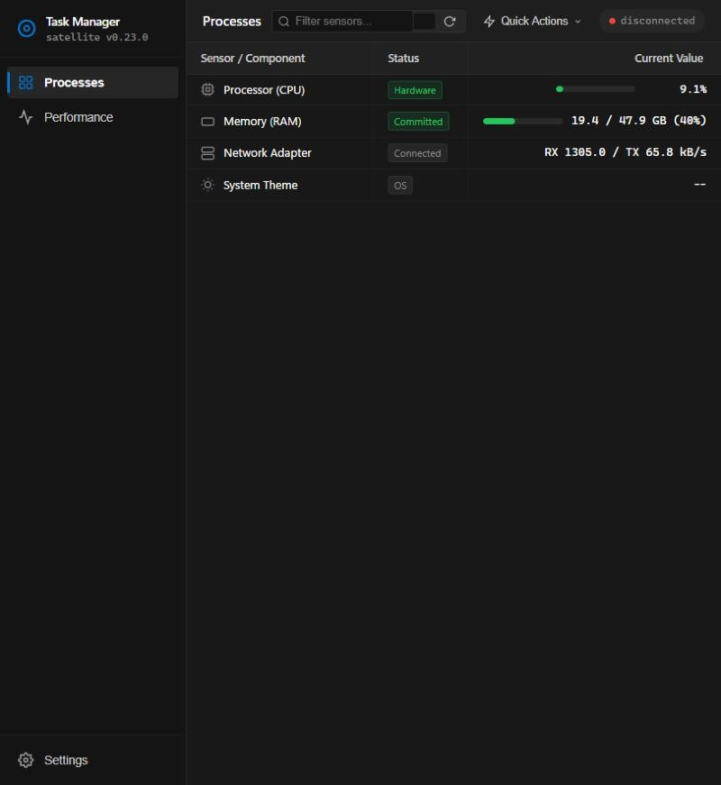
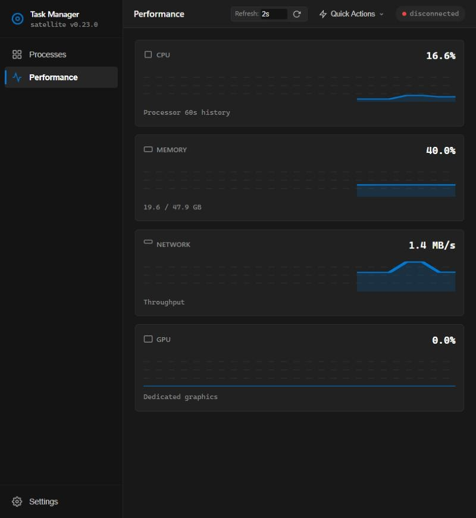
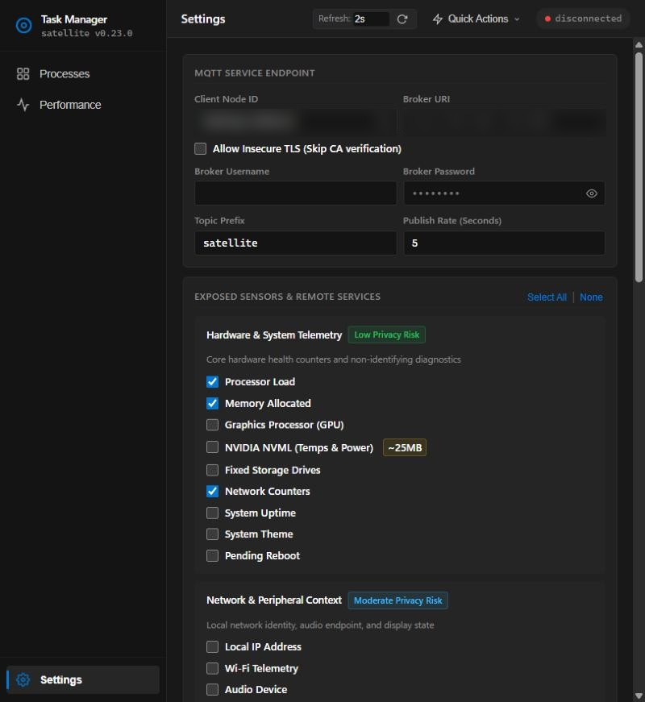

# Satellite

Turn your devices into Home Assistant sensors and controls over MQTT.

This is a monorepo containing the Satellite apps:

| App | Path | Description |
| --- | --- | --- |
| Windows & Linux | [`windows/`](windows/) | Lightweight telemetry agent and remote controller. Written in Go. |
| Android | [`android/`](android/) | Companion app with MQTT Discovery and a foreground service. Written in Kotlin. |

## Screenshots

The Windows & Linux agent's local web UI:

| Processes | Performance | Settings |
| --- | --- | --- |
|  |  |  |

Each app has its own README with build and setup instructions:

- [`windows/README.md`](windows/README.md)
- [`android/README.md`](android/README.md)

## Documentation

Start with the [documentation index](docs/README.md) for setup and integration guides.

- [Architecture](docs/architecture.md): components, data flow, and lifecycle.
- [MQTT and webhooks](docs/mqtt-and-webhooks.md): topics, commands, payloads, and platform differences.
- [Troubleshooting](docs/troubleshooting.md): connectivity, discovery, reporting, and current limitations.
- [Contributing](CONTRIBUTING.md): development, testing, versioning, and releases.
- [Security policy](SECURITY.md): private vulnerability reporting.

## Releases

Both apps ship in one release. Bump `Version` in `windows/internal/config/config.go` and push to `main`, and [`release.yml`](.github/workflows/release.yml) builds everything and publishes a single `vX.Y.Z` release containing:

- `satellite.exe` and `Satellite-Setup-vX.Y.Z.exe` (Windows)
- `satellite-linux-amd64` (Linux)
- `satellite-vX.Y.Z.apk` (Android, signed)

The desktop agent checks the release tag and links to the release for download. The Android app can download, verify, and install the `.apk` attached to the latest release.

## Disclaimer

Written with AI, reviewed by a human.
